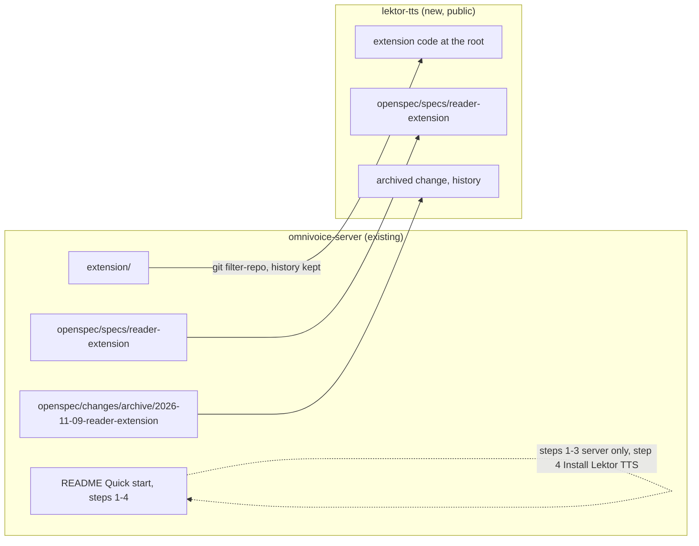
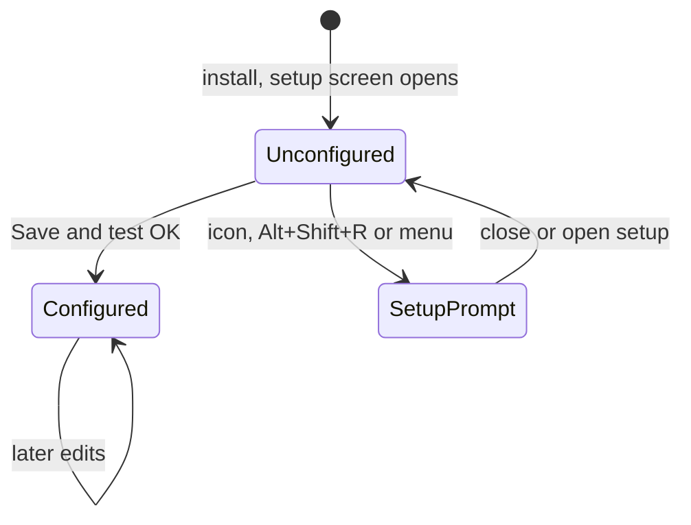
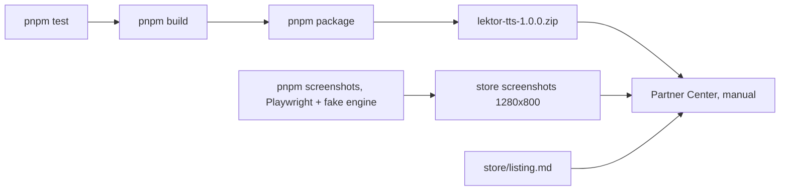

# Design: edge-store-publish

## Glossary

- **Store listing**: the extension's public page on Microsoft Edge Add-ons, visible in store search.
- **Engine preset**: a named starting configuration on the setup screen (OpenAI, own omnivoice-server, other OpenAI-compatible) that fills base URL, model and voice list.
- **Setup screen**: the options page in its first-run state, opened on install, where the user picks an engine preset and tests the connection.
- **Unconfigured**: the state before any engine preset was saved; starting a reading session then shows a setup prompt instead of an engine error.
- **Fake engine**: a local test HTTP server speaking the OpenAI `/audio/speech` protocol with silent audio, used for screenshots and visual verification without a GPU or key.

## Decisions

- **Public listing** (not hidden): anyone can find and install it, so first run must work for a stranger without our server.
- **Name: Lektor TTS** (package `lektor-tts`, version 1.0.0): neutral, avoids implying k2-fsa endorsement; OmniVoice appears only in the description as one compatible server. The repo `omnivoice-server` keeps its name (descriptive use).
- **Own repo `gmotyl/lektor-tts`** (public, MIT), history kept via `git filter-repo` (only `extension/` moved to the root, plus the `reader-extension` OpenSpec paths; old messages may reference omnivoice-server PRs #3/#5). Creating the GitHub repo needs Greg's explicit approval at execution time.
- **Workspace home: the `omnivoice-server` project**: `repos.json` gains `lektor-tts` (`/srv/git/prv/lektor-tts`, openspec native); mockups, memos and progress stay under `projects/omnivoice-server/`.
- **Setup screen = mockup option A** (preset cards above the form); one page serves first run and later edits.
- **OpenAI preset model**: default `gpt-4o-mini-tts` (11 voices incl. `ballad`, `verse`); `tts-1` and `tts-1-hd` selectable under "More settings" with 9 voices; the voice list follows the model. The per-model voice lists and counts (11 / 9) are from memory and are verified against OpenAI's TTS docs in the presets task; the spec counts follow whatever that check finds. Prices quoted anywhere are re-checked against OpenAI's pricing page when written.
- **Icon = mockup option B** (white "L" with two yellow sound arcs on a navy rounded tile), one SVG source rendered by a script.
- **Manual release**: `pnpm package` zip, uploaded by hand in Partner Center; the first submission must be manual anyway. No Edge API automation, no Chrome Web Store, no CI in this change. The plan ends at "submitted"; certification is outside our hands.
- **Buy me a coffee**: pavilio-style badge footer in both READMEs (below); one closing line in the store description; a small footer link on the options page below "More settings"; never in the player bar.

  ```markdown
  Created by Greg Motyl — [github.com/gmotyl](https://github.com/gmotyl)

  [](https://buymeacoffee.com/motyl.dev)
  ```

## Repo split



1. In a throwaway clone of `omnivoice-server`, `git filter-repo --path extension/ --path-rename extension/: --path openspec/specs/reader-extension/ --path openspec/changes/archive/2026-11-09-reader-extension/ --path openspec/changes/2026-11-10-edge-store-publish/` → `/srv/git/prv/lektor-tts`, branch `main`.
2. With approval: create public `gmotyl/lektor-tts`, add MIT `LICENSE`, push `main`.
3. `omnivoice-server` PR to `master`: delete `extension/` and `openspec/specs/reader-extension/` (the archived change stays as history); README Quick start steps 1–3 server-only, step 4 "Install Lektor TTS" (store link once known + repo link); "Reader extension" section → short link section; footer badge.
4. `projects/omnivoice-server/repos.json` gains `lektor-tts`.
5. Change artifacts split as described in the proposal.

## Extension changes (lektor-tts)



- **Rename**: "Lektor TTS" in manifest `name`, `action.default_title`, options `<title>`/heading; `package.json` name `lektor-tts`; version 1.0.0 in both files.
- **`src/presets.mjs`**: `openai` (base `https://api.openai.com/v1`, models `gpt-4o-mini-tts` default, `tts-1`, `tts-1-hd`, voices per model), `omnivoice` (base `http://localhost:8892/v1`, voices from the engine), `other` (user base URL, voices from the engine or free text).
- **Settings**: new key `preset` (`""` = unconfigured). Migration on load: no `preset` but any stored engine key differs from the old defaults → `preset` inferred (`localhost:8892`/`127.0.0.1:8892` → `omnivoice`, `api.openai.com` → `openai`, else `other`) and written back. Defaults otherwise unchanged except the OpenAI preset's model.
- **Install**: `chrome.runtime.onInstalled` with `reason === "install"` → `chrome.runtime.openOptionsPage()`; updates open nothing.
- **Unconfigured prompt**: any start trigger while `preset` is empty injects the content script and shows the setup prompt bar; no `/audio/speech` request is made. "Set up a speech engine" opens the options page; × removes the bar.
- **Save and test**: (1) non-localhost origin → `chrome.permissions.request` for it (OpenAI → `https://api.openai.com/*`); denied → nothing saved, message "Lektor needs permission to reach <origin>"; (2) save; (3) test — OpenAI: `GET /models` with the key, voices from the preset; others: existing `listVoices`; (4) "✓ Connected to <preset label> · N voices" or the engine's error message.
- **Options page**: layout per the setup-screen mockup; "More settings" is a `<details>` holding speed, autoscroll and model; footer link "Buy me a coffee".
- **Icon**: `icons/icon.svg` source; `scripts/render-icons.mjs` (dev dependency `@resvg/resvg-js`) writes `icons/icon16.png`, `icon48.png`, `icon128.png` and `store/logo-300.png`, all committed.

## Release kit (lektor-tts)



- **`scripts/package.mjs`** (`pnpm package`, dev dependency `fflate`): builds first, then zips `manifest.json`, `dist/**`, `src/**` except `__tests__`, `icons/*.png` into `lektor-tts-<version>.zip`; fails when `manifest.json` and `package.json` versions differ. The zip is git-ignored.
- **`scripts/screenshots.mjs`** (`pnpm screenshots`, dev dependency `playwright`): Chromium with the unpacked extension, the fake engine (`scripts/fake-engine.mjs`, silent mp3, voices `["demo-1","demo-2"]`) and a local sample article. Writes `store/screenshot-reading.png` (highlight + player bar), `store/screenshot-setup.png` (OpenAI card selected), `store/screenshot-unconfigured.png` (setup prompt bar), all 1280×800, plus `qa/visual/setup-390.png`, `qa/visual/setup-1280.png`, `qa/visual/icon-toolbars.png` for visual verification.
- **`store/listing.md`**: name, short description, full description (features, three engines, OpenAI setup, link to the omnivoice-server Quick start, closing coffee line), category (Productivity; Accessibility considered), support URL (GitHub Issues), privacy policy URL, one justification line per permission (`activeTab`, `scripting`, `offscreen`, `contextMenus`, `storage`, localhost hosts, optional `http(s)://*/*`), and "Notes for certification" test steps (the key itself is pasted by Greg, never committed).
- **`PRIVACY.md`**: no data collected; page text goes only to the configured engine; settings including the API key live in `chrome.storage.sync`; no analytics, no remote code.
- **README** (lektor-tts): what it is, install from Edge Add-ons (link once published), setup per preset, using it, troubleshooting, development, § Releasing checklist (bump version → `pnpm test` → `pnpm package` → `pnpm screenshots` if UI changed → upload + paste `listing.md` → tag `v<version>`), footer badge.

## Error handling

- Wrong key (401): "Save and test" shows the engine message under the button; settings stay saved. Reading with a bad key → the existing error bar with "Open options" and Retry.
- Permission denied → nothing saved, "Lektor needs permission to reach <origin>".
- omnivoice-server down → unreachable message plus the Quick start link.

## Testing

- Unit (`node --test` + linkedom): presets and per-model voices; settings migration; unconfigured start shows the prompt with no engine call; `onInstalled` opens options only on `install`; Save-and-test with fake `fetch` and fake `chrome.permissions`; package version check and zip contents.
- `pnpm screenshots` + visual verification against both mockup checks.
- omnivoice-server after the removal: its Python and relay tests, `./omnivoicectl status`, `smoke_test.py` on SPOCK; the Quick start renders on GitHub without the extension build step.
- Manual smoke in Edge with the zip loaded unpacked: OpenAI with a real key, omnivoice-server on SPOCK, and a fresh profile to see the setup screen open on install.

## Mockups

### [projects/omnivoice-server/mockups/2026-11-10-lektor-icon-options.html](/project/omnivoice-server/mockups?file=omnivoice-server%2Fmockups%2F2026-11-10-lektor-icon-options.html)
- Surface: extension icon (toolbar 16/48/128) and store logo (300), option B only
- Check:
  - single source `icons/icon.svg` (lektor-tts root), viewBox 0 0 128 128
  - navy rounded tile `#1e2a4a`, corner radius 28/128, fills the square with no transparent margin
  - white "L", stroke 18/128, round caps and join, on the left half
  - two concentric yellow sound arcs `#ffd54a`, stroke 8, coming out of the L's corner, inside the tile
  - PNGs 16, 48, 128 (manifest) and 300 (store logo) rendered from that SVG by a script; no hand-drawn variants
  - at 16 px the "L" and at least the outer arc stay visible on a light `#f3f3f3` and a dark `#2b2b2b` toolbar
- Agreed deviations:
  - none

### [projects/omnivoice-server/mockups/2026-11-10-lektor-setup-screen-options.html](/project/omnivoice-server/mockups?file=omnivoice-server%2Fmockups%2F2026-11-10-lektor-setup-screen-options.html)
- Surface: options page (setup screen, option A) and the player bar while unconfigured; viewports 390px and 1280px
- Check:
  - header: icon B + "Lektor TTS", lede "Lektor reads web pages aloud through a text-to-speech server. Choose one to get started."
  - "Speech engine": three selectable cards in order OpenAI ("Paste an API key. Paid per use."), omnivoice-server ("Free, runs on your own computer."), Other server ("Any OpenAI-compatible endpoint."); selected card = navy border + yellow dot; cards wrap at narrow width
  - OpenAI card → API key field (hint: where to create it, sent only to OpenAI) + select of OpenAI's fixed voice list; no URL field
  - omnivoice-server card → address `http://localhost:8892/v1`, "Quick start" link to `https://github.com/gmotyl/omnivoice-server#quick-start-read-web-pages-aloud` (new tab) mentioning `./omnivoicectl start`; voice list after a successful test
  - Other server card → base URL, optional API key, voice listed by the server or typed
  - one primary button "Save and test" (replaces Save + Test connection); success: "✓ Connected to … · N voices" + a hint how to start reading
  - speed, autoscroll and model under "More settings ▸", collapsed by default
  - player bar while unconfigured: "Lektor needs a speech engine before it can read.", yellow "Set up a speech engine" button opening the setup screen, × closes the bar; no error state, no Retry
- Agreed deviations:
  - mockup shows "9 voices" → we show the count of the shipped OpenAI voice list, because the number is an example
  - mockup shows a relative "Quick start" link → we link to GitHub, because the installed extension does not ship the repo README
  - mockup has no footer → the options page gets a small "Buy me a coffee" footer link below "More settings", decided after the mockup

Visual verification: yes
