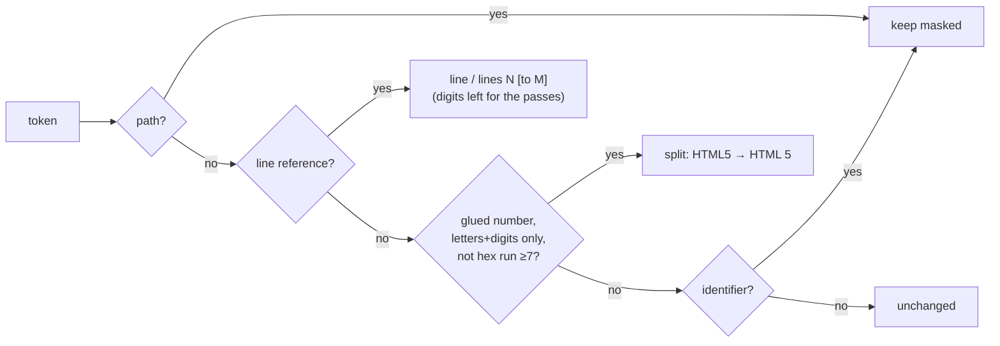

# Design: Numbers glued to letters are spoken

## Context

`normalize(text, language)` masks protected spans (`_mask`), runs `PASSES` (dates, money, ranges,
percentages, units, grouped thousands, decimals, integers, abbreviations), then unmasks. In `_mask`,
each whitespace token is protected when `_is_path` or `_is_identifier` holds, and `_is_identifier` is
true for **any** digit touching a letter or underscore, or a `KEY=value` assignment. So `L27–33` never
reaches the integer pass.

## Decision

The rewrite happens inside `_mask`'s per-token step, **before** the identifier check, so URLs and
bracket tags (masked first) and paths (checked first) are never touched.

The rewrite only produces words and spaced digits. The existing passes then spell the digits in the
request's language (`_integers`, `_units`). That keeps a single set of number rules: `60s` → `60 s` →
"sixty seconds" through the units pass, and `L 5` → "L five" through the integer pass.

### Line reference

`^L([0-9]+)(?:[–-]L?([0-9]+))?$` (ASCII digits only, like `_integers`) on the token core (leading and trailing punctuation already stripped):

| Token | en | pl |
|---|---|---|
| `L27–33`, `L27-33`, `L27–L33` | lines 27 to 33 | linie 27 do 33 |
| `L27`, `L120` (≥ 2 digits) | line 27 | linia 27 |
| `L5` (1 digit, no range) | not a line reference → glued number → `L 5` | `L 5` |

The digits are left for `_integers`. Polish uses plain cardinals ("linie dwadzieścia siedem do
trzydzieści trzy"), matching the normaliser's existing range word `do`. Only a capital `L` counts.
A single digit is not treated as a line (`L2 cache`, `L4 load balancer`), but the generic rule still
says its digit.

### Glued number

A token core made only of letters and ASCII digits (`^(?:[^\W\d_]|[0-9])+$`) with a digit touching a
letter, and **not**
a hex run (`^[0-9a-fA-F]{7,}$` with both a digit and a hex letter): spaces are inserted at every
letter/digit boundary. `HTML5` → `HTML 5`, `mp3` → `mp 3`, `4K` → `4 K`, `B2B` → `B 2 B`,
`60s` → `60 s`. Only ASCII `[0-9]` counts, as in `_integers`: a token with other scripts' digits
(`HTML５`, `L２７`) is neither a glued number nor a line reference and stays masked as before.

Still protected (unchanged behaviour): `x86_64`, `OMNIVOICE_STEPS=16`, `v1.2.3`, `7d1a98c`,
`report.2026.txt`, paths, URLs, `[laughter]`.

Known and accepted: a glued unit with a different meaning (`5m` = minutes) gets whatever the units pass
says for `5 m`. `the 60s` (the decade) becomes "sixty seconds".

## Error handling

The rewrite runs inside `_mask`, which already makes any exception leave the text unchanged and log a
warning ("Normalisation never fails a request").

## Testing

Table-driven cases in `tests/test_normalize.py`, for both `en` and `pl`: each row above, the
protected list, a line reference with trailing punctuation (`L27–33.`), a path followed by a line
note (`src/app.config.ts · L27–33`), and lowercase `l27`, which is not a line reference and is
spoken as a glued number ("l twenty-seven"), not as a line. The integer pass is then checked end to
end ("line twenty-seven").

## Glossary

- **Line reference** — a capital `L` with a line number or range (`L27`, `L27–33`) in text sent for synthesis, spoken as "line"/"lines" in the request's language.
- **Glued number** — a run of digits touching letters inside a letters-and-digits token (`HTML5`, `L5`), spoken by splitting it from the letters.
