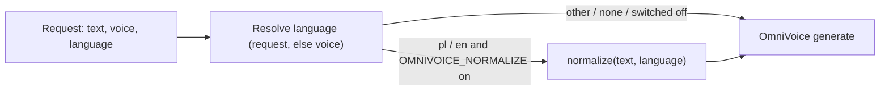

# Design: text normalisation (Polish and English)

## Placement

`normalize.py` exposes one function, `normalize(text: str, language: str) -> str`, with no
dependency on FastAPI or the model. `build_kwargs` calls it after the language is resolved, and
only for the base codes `pl` and `en` (a locale such as `pl-PL` is reduced to its prefix).
`OMNIVOICE_NORMALIZE` is read once at import time. Its default is on, and `0`, `false` or `off`
turn it off.

## Rewrite order

Each pass is a regular expression over the text. The passes run in this order, so a more specific
pattern consumes its digits before a more general one sees them:

1. **Protected spans** are masked first and restored at the end: OmniVoice bracket tags
   (`[laughter]`, `[B EY1 S]`), URLs, file paths, and identifiers where digits touch letters or
   underscores (`OMNIVOICE_STEPS=16`, `v1.2.3`, `x86_64`, `mp3`).
2. **Dates**:
   - Polish: `5.11.2026`, `05.11.2026` and ISO `2026-11-05` → day as a nominative ordinal +
     month in the genitive + year as a cardinal ("piąty listopada dwa tysiące dwadzieścia sześć").
     `5 listopada 2026` → the same, with the written month kept.
   - English: ISO and `November 5, 2026` / `5 November 2026` → "November fifth, twenty
     twenty-six" (`num2words(to="year")`). An ambiguous `5/11/2026` is not a date pattern.
3. **Money** (before ranges, so `10–20 zł` is read as one amount range): a symbol or code before
   or after an amount — `12,50 zł`, `12,50 PLN`, `$12.50`, `12.50 USD`, `5 €`, `€5`, `£3`,
   `100 Kč`, `20 CHF`. The amount is parsed as a `Decimal` with the language's decimal separator
   and grouped thousands.
   - PLN, EUR and USD (both languages) and GBP (English) go through
     `num2words(Decimal, to="currency")`, which declines correctly ("trzy złote, pięćdziesiąt
     groszy"). A zero minor part is dropped ("pięć euro", not "pięć euro, zero centów"), and the
     long Polish "dolarów amerykańskich" is shortened to "dolarów".
   - GBP in Polish, CHF and CZK (both languages) use a small local table of word forms. Polish
     picks the form with the standard plural rule: 1 → singular ("korona"), 2–4 except 12–14 →
     "korony", else → "koron". Feminine units (korona) take "jedna" and "dwie", including
     inside compounds ("dwadzieścia dwie korony"). English uses singular for 1 and plural otherwise. The minor unit
     (pens, rappen/centymy, halerze) follows the same rule.
   - A range of amounts (`10–20 zł`) reads both numbers in the nominative and names the currency
     once, in the form the last number takes ("dziesięć do dwadzieścia złotych").
4. **Ranges** (an amount range with a currency has already been taken by pass 3): number, `–` or `-`, number, with no spaces around a hyphen → "X do Y" / "X to Y".
   A spaced hyphen or a spaced en dash (` – `) is a dash in prose, not a range. Date patterns
   have already been taken.
5. **Percentages**: `15%`, `1,5 %` → "piętnaście procent" / "fifteen percent".
6. **Units after a number** (whole token, case-sensitive): s, ms, min, h, KB, MB, GB, TB, Hz,
   kHz, px → a fixed word per language. Polish uses the plural form for any number ("sekundy",
   "gigabajty"), following the nominative-only decision. English uses "second" for 1 and
   "seconds" otherwise.
7. **Grouped thousands** (before decimals, so `1 234,5` is one number): `3 100` and `3 100` (non-breaking space) in Polish, `3,100` in English →
   the digits joined, keeping any decimal part. The pattern requires groups of exactly three digits, so the Polish decimal `1,2`
   never matches it.
8. **Decimals**: the Polish comma (`1,2`) and the English point (`1.2`) → `num2words(Decimal)`
   ("jeden przecinek dwa", "one point two"). A `Decimal`, not a `float`, so trailing digits
   survive: `1,10` → "jeden przecinek dziesięć". Digits after the separator are read as a number,
   as num2words does. An all-zero fraction is read digit by digit (`2,00` → "dwa przecinek zero
   zero"), since num2words drops or garbles it.
9. **Integers** → cardinal `num2words`.
10. **Abbreviations** (whole token, with its dot):
   - Polish: ok. → około, np. → na przykład, tj. → to jest, m.in. → między innymi, itd. →
     i tak dalej, tzw. → tak zwany, godz. → godzina, r. (after a year) → roku.
   - English: e.g. → for example, i.e. → that is, approx. → approximately, vs. → versus.
11. **Acronyms — removed.** Spelling all-caps tokens with letter names (pl `API` → "a pe i")
    was implemented and then removed after the listening check (2026-11-05): OmniVoice pronounces
    all-caps acronyms correctly by itself, and the letter-name spelling degraded the output.
    All-caps tokens now pass through unchanged.

**Why whole tokens:** a loose match in another project's pronunciation map rewrote ordinary
Polish words. Every pattern here is anchored to a token boundary and is case-sensitive.

## num2words notes

- A bare `int` passed to `to="currency"` is treated as minor units (199 → 1.99). Always pass a
  `Decimal`.
- Polish has no GBP, CHF or CZK; English has no CHF or CZK. Those go through the local table.

## Error handling

`normalize` never raises to the caller. If one pass throws on odd input, that pass is skipped for
the request, a warning is logged with the pass name, and the remaining passes still run.

## Testing

- `tests/test_normalize.py`: a parametrised table of input → expected output per pass and language,
  including the 2026-11-05 sentence that got swallowed, the protected spans, all-caps
  acronyms left unchanged, and each currency in both positions with 1, 2, 5, 12 and 22 units.
- `tests/test_speech_normalize.py`: through the TestClient and the fake model, `generate`
  receives normalised text for `pl` and `en`, unchanged text for another language, and unchanged
  text when `OMNIVOICE_NORMALIZE=0`.
- Verification sentences (`audition/normalize_sentences.txt`, PL and EN, covering numbers, dates,
  ranges, units, amounts and acronyms) are rendered on `krystyna1` and one English voice with the switch off
  and on. The results go on a listening page in the tts-providers mockups, with each render's
  length shown.

## Glossary

- **Normalisation** — rewriting written-only tokens (digits, symbols, abbreviations) into the words a speaker would say, before synthesis. _Avoid:_ "text cleanup", "stripping".
- **Protected span** — a stretch of text that normalisation must leave byte-for-byte unchanged (bracket tags, URLs, paths, identifiers).
