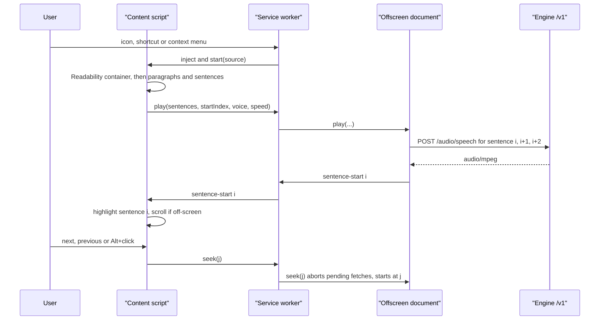
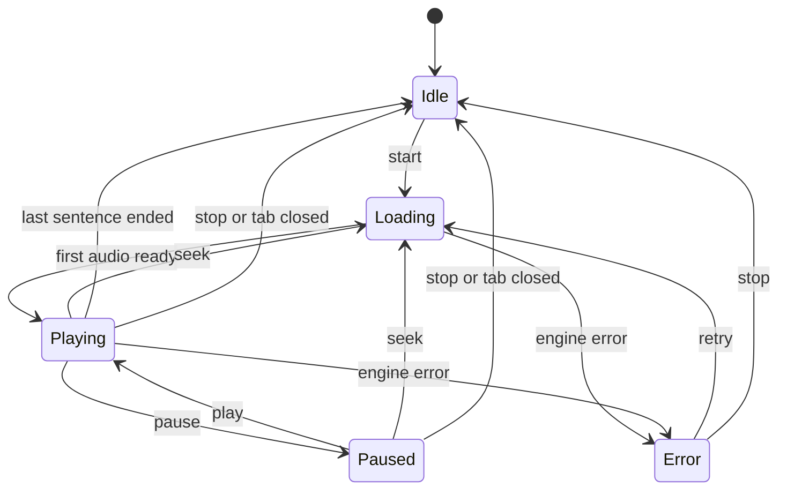

# Design: reader-extension

## Glossary

- **Reading session**: one run of reading in one tab, from start to stop, over a fixed list of sentences.
- **Sentence**: the unit of synthesis, navigation and highlighting; one `/audio/speech` request each.
- **Paragraph**: a block element of the reading source; Shift+prev/next jumps between paragraph starts.
- **Reading source**: what a session reads — the article container or the current selection.
- **Article container**: the DOM element Readability identifies as the main content; read in place, never replaced.
- **Player bar**: the floating control strip the extension injects at the bottom of the page.
- **Engine**: any server speaking the OpenAI `/audio/speech` protocol at the configured base URL.

## Context

- `narrate/server.mjs` already exposes `GET /v1/models`, `GET /v1/audio/voices` (`{voices: [id]}`)
  and `POST /v1/audio/speech` (`{input, voice}` → whole `audio/mpeg`) with permissive CORS. It
  ignores `speed`; the server-side default speed comes from `OMNIVOICE_SPEED`.
- Text normalisation (living spec `text-normalisation`) happens in the server, so the extension
  sends raw sentence text.
- Chrome's Local Network Access blocks page-originated requests to localhost from public origins,
  but extension contexts holding host permissions are not covered — so all fetching happens in the
  extension, never in the page's context.

## Components

```
extension/
  manifest.json        MV3; permissions: activeTab, scripting, offscreen, contextMenus, storage
                       host_permissions: http://localhost/*, http://127.0.0.1/*
                       optional_host_permissions: http://*/*, https://*/*
                       commands: toggle-reading (Alt+Shift+R)
  src/background.mjs   service worker: action click / command / context menu → inject content,
                       ensure offscreen document, route messages between tab and offscreen
  src/content/         bundled by esbuild into dist/content.js
    segment.mjs        container → paragraphs → sentences (Intl.Segmenter, lang from <html lang>),
                       each sentence = {text, range, paragraph}
    source.mjs         Readability container, <body> fallback, selection source
    highlight.mjs      CSS.highlights "reader-current", scrollIntoView when off-screen
    bar.mjs            player bar in a closed Shadow DOM
    main.mjs           session state, Alt+click, keyboard on the bar, messaging
  src/offscreen.html / offscreen.mjs
    queue.mjs          sentence queue: prefetch 3, AbortController per request, seek(i)
    player.mjs         <audio>, playbackRate, events sentence-start / ended / error
  src/options.html / options.mjs
                       baseUrl, apiKey, voice, speed; "Test connection"; permission request
  src/engine.mjs       OpenAI client: listVoices(), speak(text, voice, signal)
  src/**/__tests__/    node --test with linkedom, next to the code under test
  build.mjs            esbuild bundle of content/main.mjs → dist/
  README.md            what it is, requirements, build, Load unpacked in Chrome and Edge,
                       options, using it, troubleshooting, development (test, build, reload)
```

## Data flow





## Decisions

- **Sentence per request** (not the Narrate WebSocket stream): exact highlight sync and instant
  seek, and the extension works with any OpenAI-compatible engine. Cost: a short gap is possible on
  a slow engine; prefetching 3 sentences hides it.
- **Read in place**: Readability only picks the container; ranges point into the original DOM, so
  the page keeps its layout and the highlight never mutates the DOM (CSS Custom Highlight API).
- **Offscreen document plays audio** (reason `AUDIO_PLAYBACK`): avoids page CSP on `blob:` media,
  CORS and Local Network Access; survives the service worker going idle.
- **Narrow permissions**: injection on user gesture via `activeTab` + `scripting`; a non-localhost
  base URL triggers `chrome.permissions.request` for its origin when saved.
- **Speed is client-side** (`playbackRate`, pitch preserved), because the adapter ignores `speed`.
- **Long sentences**: a sentence over 400 characters is cut at the last space before 400, so one
  request stays short; the pieces share the sentence's highlight.
- **No retries**: an engine error stops the session and shows the error in the player bar with an
  "Open options" link and a Retry button.

## Settings (`chrome.storage.sync`)

| Key | Default |
| --- | --- |
| `baseUrl` | `http://localhost:8892/v1` |
| `apiKey` | empty → no `Authorization` header |
| `voice` | first voice the engine lists |
| `speed` | `1.0` (range 0.5–2.0, step 0.1) |
| `model` | `tts-1` (sent as-is; our adapter ignores it) |

## Documentation

`extension/README.md` is the entry point for anyone installing or changing the extension:

- **What it is**: one paragraph and the feature list (article, selection, Alt+click, sentence and
  paragraph navigation, highlight, voice, speed).
- **Requirements**: Chrome or Edge with MV3 and the CSS Custom Highlight API (Chrome/Edge 116+: offscreen documents need 109+, `chrome.runtime.getContexts` 116+),
  Node 22+ to build, and an OpenAI-compatible TTS server — by default our adapter
  (`./omnivoicectl start`, `http://localhost:8892/v1`, see the top-level README § Narrate / Read
  Aloud adapter); `https://api.openai.com/v1` with a key works too.
- **Build and install**: `npm install`, `npm run build`, then Load unpacked from `extension/` via
  `chrome://extensions` / `edge://extensions` with Developer mode on.
- **Options**: each setting, its default, and the host-permission prompt for a non-local server.
- **Using it**: triggers (icon, `Alt+Shift+R`, context menu), player bar controls, Alt+click,
  Shift+previous/next, and how to change the shortcut (`chrome://extensions/shortcuts`).
- **Troubleshooting**: engine unreachable (`./omnivoicectl status`), empty voice list, page with no
  article, reload the extension after a rebuild.
- **Development**: `npm test`, `npm run build`, file map, where the spec lives
  (`openspec/specs/reader-extension/spec.md` after archive).

The top-level `README.md` gets a short "Reader extension" section linking to it.

## Testing

- Unit (`node --test`, linkedom): segmentation for Polish and English (abbreviations, decimals with
  comma, quotes), paragraph boundaries, selection clipping, long-sentence cut, queue prefetch and
  abort with a fake `fetch`, seek and paragraph jumps, voice list fallback.
- Manual smoke checklist in Chrome and Edge against the adapter on 8892 (tasks.md).
