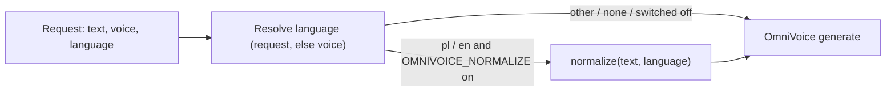

# Design: text normalisation (Polish and English)

## Placement

`normalize.py` exposes one function, `normalize(text: str, language: str) -> str`, with no
dependency on FastAPI or the model. `build_kwargs` calls it after the language is resolved, and
only for the base codes `pl` and `en` (a locale such as `pl-PL` is reduced to its prefix).
`OMNIVOICE_NORMALIZE` is read once at import time. Its default is on, and `0`, `false` or `off`
turn it off.

## Rewrite order

Each pass is a regular expression over the text. The passes run in this order, so a more specific
pattern consumes its digits before a more general one sees them:

1. **Protected spans** are masked first and restored at the end: OmniVoice bracket tags
   (`[laughter]`, `[B EY1 S]`), URLs, file paths, and identifiers where digits touch letters or
   underscores (`OMNIVOICE_STEPS=16`, `v1.2.3`, `x86_64`, `mp3`).
2. **Dates**:
   - Polish: `5.11.2026`, `05.11.2026` and ISO `2026-11-05` → day as a nominative ordinal +
     month in the genitive + year as a cardinal ("piąty listopada dwa tysiące dwadzieścia sześć").
     `5 listopada 2026` → the same, with the written month kept.
   - English: ISO and `November 5, 2026` / `5 November 2026` → "November fifth, twenty
     twenty-six" (`num2words(to="year")`). An ambiguous `5/11/2026` is not a date pattern.
3. **Ranges**: number, `–` or `-`, number, with no spaces around a hyphen → "X do Y" / "X to Y".
   A spaced hyphen is a dash in prose, not a range. Date patterns have already been taken.
4. **Percentages**: `15%`, `1,5 %` → "piętnaście procent" / "fifteen percent".
5. **Units after a number** (whole token, case-sensitive): s, ms, min, h, KB, MB, GB, TB, Hz,
   kHz, px → a fixed word per language. Polish uses the plural form for any number ("sekundy",
   "gigabajty"), following the nominative-only decision. English uses "second" for 1 and
   "seconds" otherwise.
6. **Decimals**: the Polish comma (`1,2`) and the English point (`1.2`) → `num2words(float)`
   ("jeden przecinek dwa", "one point two"). Digits after the separator are read as a number, as
   num2words does.
7. **Grouped thousands**: `3 100` and `3 100` (non-breaking space) in Polish, `3,100` in English →
   one integer. The pattern requires groups of exactly three digits, so the Polish decimal `1,2`
   never matches it.
8. **Integers** → cardinal `num2words`.
9. **Abbreviations** (whole token, with its dot):
   - Polish: ok. → około, np. → na przykład, tj. → to jest, m.in. → między innymi, itd. →
     i tak dalej, tzw. → tak zwany, godz. → godzina, r. (after a year) → roku.
   - English: e.g. → for example, i.e. → that is, approx. → approximately, vs. → versus.
10. **Acronyms**: a whole token of 2–5 uppercase ASCII letters, optionally with a lowercase plural
    `s` (`PRs`). It is spelled with that language's letter names (Polish "a pe i", "te te es";
    English "A P I"), unless the token is in that language's read-as-word map (NATO, RAM, JSON,
    ASAP, …). Mixed-case words (`OmniVoice`, `iPhone`) and single capitals are left alone.

**Why whole tokens:** a loose match in another project's pronunciation map rewrote ordinary
Polish words. Every pattern here is anchored to a token boundary and is case-sensitive.

## num2words notes

- A bare `int` passed to `to="currency"` is treated as minor units (199 → 1.99). Currency is out of
  scope, but the trap is noted in case the scope grows.
- Polish currency support has no CZK.

## Error handling

`normalize` never raises to the caller. If one pass throws on odd input, that pass is skipped for
the request, a warning is logged with the pass name, and the remaining passes still run.

## Testing

- `tests/test_normalize.py`: a parametrised table of input → expected output per pass and language,
  including the 2026-11-05 sentence that got swallowed, the protected spans, and the acronym
  exceptions.
- `tests/test_speech_normalize.py`: through the TestClient and the fake model, `generate`
  receives normalised text for `pl` and `en`, unchanged text for another language, and unchanged
  text when `OMNIVOICE_NORMALIZE=0`.
- Verification sentences (`audition/normalize_sentences.txt`, PL and EN, covering numbers, dates,
  ranges, units and acronyms) are rendered on `krystyna1` and one English voice with the switch off
  and on. The results go on a listening page in the tts-providers mockups, with each render's
  length shown.

## Glossary

- **Normalisation** — rewriting written-only tokens (digits, symbols, abbreviations, acronyms) into the words a speaker would say, before synthesis. _Avoid:_ "text cleanup", "stripping".
- **Protected span** — a stretch of text that normalisation must leave byte-for-byte unchanged (bracket tags, URLs, paths, identifiers).
- **Read-as-word acronym** — an all-caps token said as a word (NATO, RAM, JSON) rather than spelled letter by letter.
